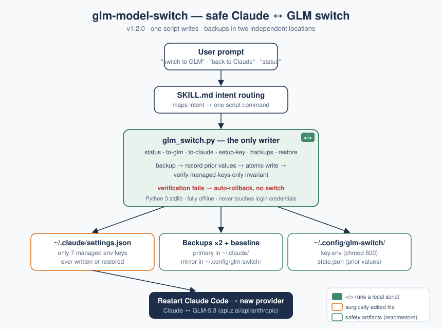

# glm-model-switch

Prompt-driven, fully reversible switching of Claude Code (Mac app / CLI) between **Claude (Anthropic)** and **GLM-5.3 via Z.AI** — with backups, exact prior-state restore, and verified atomic writes. Say "switch to GLM" or "switch back to Claude" in Claude Code; the skill does the rest.

## Safety guarantees

- Only one script ever writes config; it edits exactly 7 managed `env` keys in `~/.claude/settings.json` and proves after every write that nothing else changed (auto-rollback otherwise).
- Timestamped full-file backups + a one-time baseline before any change, written to **two independent locations** (`~/.claude/glm-switch-backups/` and `~/.config/glm-switch/backups/`); `restore --latest` searches both — recovery works even if `~/.claude` is wiped entirely.
- Switching back restores each key's **exact recorded prior value** — not a guess, not a blind delete.
- Login credentials, permissions, hooks, and MCP config are never touched. Switches apply to new sessions only; restart Claude Code to take effect.
- Emergency recovery (two shell commands) documented in `references/official-config.md` — works even without the skill.

## First-time setup

1. `python3 scripts/glm_switch.py setup-key` — paste your Z.AI Coding Plan key (hidden input, stored chmod 600).
2. Say "switch to GLM" → restart Claude Code → you're on GLM-5.3 (1M context).
3. Say "switch back to Claude" → restart → exactly where you started.

Config verified against the official guide: https://docs.z.ai/devpack/tool/claude
