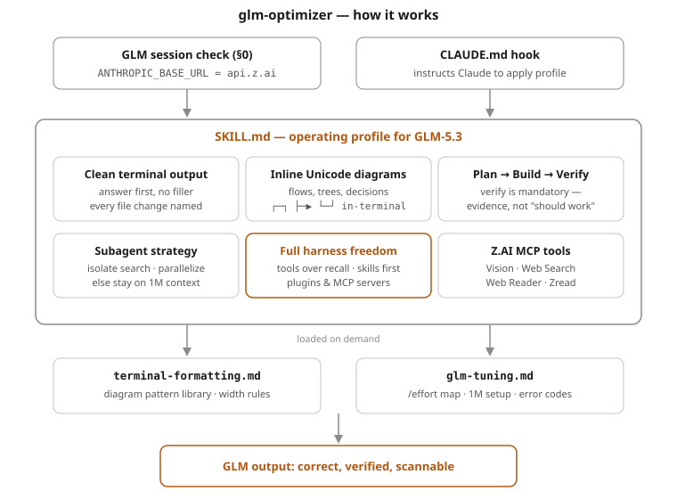

# glm-optimizer

A Claude Code skill that tunes **GLM-5.3** (Z.AI GLM Coding Plan) for cleaner terminal output,
inline Unicode diagrams, a plan→build→verify workflow, and a balanced subagent strategy on GLM's
1M-token context.

## Architecture



Two trigger paths load the profile; six pillars govern GLM's behavior; the two reference files
load only when needed.

## What it does

- **Clean terminal output** — answer-first, short blocks, named file mutations, no filler.
- **Inline diagrams** — draws flows, architectures, decisions, file trees, and call graphs as
  Unicode box-drawing art directly in the terminal (no image rendering needed).
- **Correctness workflow** — enforces a plan step and, most importantly, a *verify* step (GLM's
  weakest habit under an agentic harness).
- **Smart subagents** — clear rules for when to spawn parallel/isolated subagents vs. stay
  single-threaded on the 1M window.
- **Full harness freedom** — explicit license for GLM to use all Claude Code native tools,
  installed skills, plugins, and MCP servers (prefer tools over recall, invoke matching skills
  before improvising, call connected tools instead of reimplementing them).
- **Uses GLM's own MCP tools** — Vision, Web Search, Web Reader, Zread when configured.

## Install

1. Copy the `glm-optimizer/` folder into your Claude Code skills directory (this folder copy is
   the canonical install for Claude Code; a `.skill` file is the same content zipped — unzip it
   to the same place. The **Save skill** button applies only if you're in the Claude desktop app):

   ```bash
   mkdir -p ~/.claude/skills
   cp -r glm-optimizer ~/.claude/skills/
   ```

2. Verify the install:

   ```bash
   ls ~/.claude/skills/glm-optimizer/SKILL.md   # file exists → skill is installed
   claude
   # then in-session:
   /status      # confirm model is glm-5.3[1m] (model config, separate from the skill)
   ```

## Make it auto-trigger on GLM sessions (recommended)

A skill triggers when its description matches your request — Claude Code can't literally detect the
active model. To make it reliably load in every GLM session, add this block to your
**`~/.claude/CLAUDE.md`** (create the file if it doesn't exist):

```markdown
## Active model profile
This machine runs Claude Code against the Z.AI GLM Coding Plan (GLM-5.3, ANTHROPIC_BASE_URL =
https://api.z.ai/api/anthropic). At the start of every session, consult the `glm-optimizer` skill
and apply its operating profile — clean terminal output, inline Unicode diagrams, plan→build→verify,
and its subagent strategy — for all coding, debugging, and research work.
```

CLAUDE.md is read automatically at the start of every Claude Code session, so this instruction plus
the skill's own broad trigger description means it activates without you having to mention "GLM"
each time. The hook also re-anchors the profile after long-session context compaction.

Trade-off to know about: the trigger description is deliberately broad, so on a machine that runs
**both** GLM and Anthropic-model sessions the skill may load in non-GLM sessions too — its §0
check then makes it stand down, at a small token cost. On a GLM-dedicated setup this costs nothing.

## Files

```
glm-optimizer/
├── SKILL.md                          the operating profile (loaded on trigger)
├── README.md                         this file
├── assets/
│   └── architecture.svg              skill overview diagram (embedded above)
└── references/
    ├── terminal-formatting.md        diagram pattern library + formatting playbook
    └── glm-tuning.md                 params, /effort mapping, 1M setup, MCP installs, errors
```
